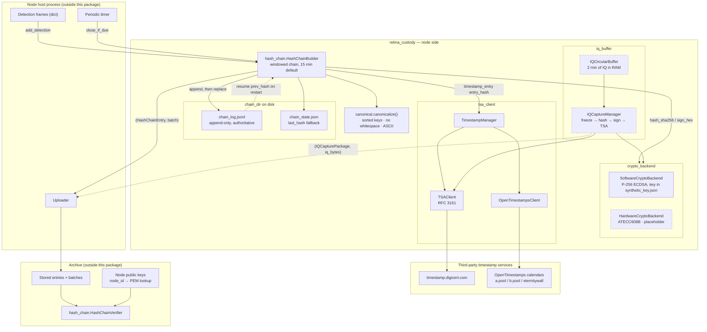

# retina-custody

Cryptographic chain of custody for RETINA passive radar detection data.

`retina_custody` is a small, dependency-light Python library (`cryptography` is the
only runtime dependency) that a RETINA node embeds to make its detection output
tamper-evident, and that an archive uses to verify what it receives. It was
extracted from the Tower-Finder backend and packaged on its own.

The design has three parts:

- **Windowed hash chain.** Detection frames are batched per clock-aligned time
  window (15 minutes by default). When a window closes the node hashes the
  canonical JSON of the batch, builds a `HashChainEntry` that links to the
  previous entry, signs it, and persists it. Individual frames are not hashed or
  signed.
- **Node-direct third-party timestamps.** Each entry hash can be submitted by the
  node itself to an RFC 3161 Timestamping Authority (DigiCert) and to
  OpenTimestamps calendar servers. Offworld Labs is not in the trust path.
- **IQ capture commitments.** A node keeps a short in-RAM circular buffer of raw
  IQ samples. On request it freezes a window, hashes and signs it, timestamps the
  hash, and produces a commitment that must be sent before the IQ bytes are
  uploaded.

The package does not include any network transport, server, or archive storage.
The host process that embeds it is responsible for calling the builder on a timer,
uploading the `(entry, batch)` pairs it returns, and storing node public keys.

## Architecture

The diagram shows the package as it exists today. Solid boxes inside
`retina_custody` are implemented and tested. Dashed boxes are either placeholders
or are implemented but not yet wired into any caller.



### What one chain entry commits to

Every hash and signature is computed over canonical JSON (`canonicalize()`:
sorted keys, no whitespace, `ensure_ascii`). Node and archive must agree on this
byte-for-byte, otherwise hashes will not match.

When a window closes, `HashChainBuilder` builds this dict, canonicalises it, and
hashes and signs the resulting bytes:

| Field | Meaning |
| --- | --- |
| `node_id` | Node identifier |
| `window_start`, `window_end` | ISO 8601 UTC, aligned to the window size, start inclusive, end exclusive |
| `prev_hash` | `entry_hash` of the previous entry, or `"genesis"` for the first |
| `detections_hash` | SHA-256 of the canonical JSON array of all frames in the window |
| `n_detections` | Number of frames in the window |
| `node_config_hash` | SHA-256 of the canonical node config at window close |
| `firmware_version` | Firmware string, `1.0.0-synthetic` by default |
| `timestamp_utc` | Creation time of the entry |

The resulting `HashChainEntry` adds `entry_hash`, `signature` (hex ECDSA P-256 /
SHA-256), `signing_mode` (`"software"` or `"hardware"`), and the optional
`tsa_token` and `ots_proof` (both base64).

```
Window N-1                          Window N
┌───────────────────────┐          ┌──────────────────────────────┐
│ prev_hash             │          │ prev_hash = hash(Window N-1) │
│ detections_hash       │──hash──► │ detections_hash              │
│ node config hash      │          │ node config hash             │
│ firmware_version      │          │ firmware_version             │
│ window_start/end      │          │ window_start/end             │
└───────────────────────┘          └──────────────────────────────┘
```

### Window lifecycle

Closing is time-driven and windows only ever close forward.

- `add_detection(frame)` records a frame in the open window. If the frame arrives
  after the window boundary, the stale window is closed first and its
  `(entry, batch)` is returned so the host can upload it. Frames that are not JSON
  serialisable raise `TypeError` or `ValueError` before anything is recorded.
- `close_if_due()` should be called from a periodic timer. A quiet window still
  closes on the boundary and produces an entry with zero detections.
- `close_window()` closes the open window regardless of the clock. Use it at
  shutdown so pending frames are committed. It returns `None` if no window is
  open.
- A clock step backwards does not reopen an earlier window. A jump forward by
  more than one window closes only the open window, and the gap is visible in the
  archive as a `window_start` that does not equal the previous `window_end`. The
  verifier does not check window continuity; the archive must do that itself.

### Persistence and recovery

Only two files are written, once per window, under `chain_dir`:

- `chain_log.jsonl`: one JSON line per entry, appended first. This is
  authoritative.
- `chain_state.json`: `{"last_hash": ...}`, written to a temp file and atomically
  replaced after the log append.

The entry is persisted before in-memory state advances. If the write fails the
exception propagates out of the closing call, the frames stay pending and the
window stays open, so the next close retries. The host should catch and log it.
On restart the builder resumes `prev_hash` from the last complete line of the
log, falling back to the state file. A partial trailing log line from a power
loss mid-append is ignored.

Pending frames live only in RAM until the window closes. Window close, including
any timestamp requests, runs synchronously under the builder's lock, so with
live timestamp services a close can block `add_detection()` for the duration of
those requests.

If `chain_dir` is not given, the default is `coverage_data/chains/<node_id>`
relative to the package's parent directory, which is inside `site-packages` for
an installed package. Always pass `chain_dir` explicitly.

### Verification

`HashChainVerifier` is the archive-side counterpart. Given a callback that
returns a node's PEM public key, `verify_entry()` checks, in order:

1. `prev_hash` matches the expected previous entry hash (when supplied).
2. `entry_hash` equals the SHA-256 of the recomputed canonical entry.
3. The ECDSA signature verifies against the node's public key.
4. When the frame batch is supplied, its SHA-256 equals `detections_hash` and
   it is a JSON list of length `n_detections`.

`verify_chain()` walks a list of entries, threading each `entry_hash` into the
next entry's expected `prev_hash`, and returns every issue found. The first
entry's `prev_hash` is not checked, so a chain can be verified from any starting
point. TSA tokens and OpenTimestamps proofs are carried on the entry but are not
validated by this package.

### Timestamping

`TimestampManager.timestamp_entry(entry_hash)` calls both services and returns
`(tsa_token, ots_proof)`. Either may be `None` if a service is unavailable, and
a failure in one does not block the other.

- `TSAClient` builds a minimal DER-encoded RFC 3161 `TimeStampReq` for a SHA-256
  digest with a random nonce and `certReq=TRUE`, posts it to
  `http://timestamp.digicert.com`, and accepts the response only if its
  `PKIStatus` is `granted` or `grantedWithMods` and a `timeStampToken` is present.
- `OpenTimestampsClient` posts the raw digest to each calendar server in turn
  and returns the first non-empty proof. Proofs start out pending; the calendar
  upgrades them to full Bitcoin proofs asynchronously. Upgrading is not handled
  here.

Requests are made directly from the node with a 15 second timeout.

### IQ capture

`IQCircularBuffer` holds `(timestamp_ms, chunk)` tuples in a deque and evicts
anything older than its duration (120 s by default). In synthetic mode,
`start()` launches a thread that appends 1 KiB random chunks once per second for
protocol testing. Nothing is written to disk.

`IQCaptureManager.capture(window_start_ms, window_end_ms)` freezes the buffer for
the window, hashes the bytes, signs them, requests a TSA timestamp for the hash,
and returns an `IQCapturePackage` plus the raw bytes. The intended ordering is
that the caller sends the package (hash, signature, TSA token) to the server and
waits for acknowledgment before uploading the IQ data, so the commitment always
precedes the data.

## Usage

Node side:

```python
from retina_custody import HashChainBuilder, SoftwareCryptoBackend, TimestampManager

crypto = SoftwareCryptoBackend(key_file="node-1/key.json")
builder = HashChainBuilder(
    node_id="node-1",
    crypto=crypto,
    node_config={"lat": 51.5, "lon": -0.1, "sample_rate": 2_000_000},
    chain_dir="node-1/chain",
    timestamper=TimestampManager(enable_tsa=False, enable_ots=False),
)

# For every detection frame. Returns (entry, batch) only if a stale window closed.
closed = builder.add_detection({"t": 1.0, "range_m": 1200.0, "doppler_hz": -43.5})

# From a periodic timer, so quiet windows still close on the boundary.
closed = builder.close_if_due()

# At shutdown, commit whatever is pending.
closed = builder.close_window()
if closed is not None:
    entry, batch = closed
```

Whenever a call returns a non-`None` `(entry, batch)`, upload both together.
`entry.to_dict()` gives a JSON-ready dict with `None` fields removed.
`HashChainBuilder` also accepts `window_s` (seconds, default 900),
`firmware_version`, and `clock` (a callable returning epoch seconds, used by the
tests to drive window boundaries).

Archive side:

```python
from retina_custody import HashChainVerifier

keys = {"node-1": crypto.get_public_key_pem()}
verifier = HashChainVerifier(get_public_key=keys.get)

ok, reason = verifier.verify_entry(entry, batch)        # (True, "ok")
ok, issues = verifier.verify_chain([entry], [batch])    # (True, [])
```

Pass `timestamper=TimestampManager()` to enable live DigiCert and OpenTimestamps
requests, or omit it to leave `tsa_token` and `ots_proof` unset.

`SoftwareCryptoBackend` generates a P-256 key pair on first use and stores it in
`key_file`. If that file exists but cannot be parsed, it logs a warning and
generates a new key pair, which changes the node's identity. Each node must have
its own key file.

`scripts/custody_server_test.py` is the reference host loop. It feeds synthetic
frames to a builder, calls `close_if_due()` every second, posts each closed
`(entry, batch)` to a retina-server and prints the server's verdict per window:

```bash
python scripts/custody_server_test.py --server http://localhost:8000 --window-s 30 --windows 4
```

A rerun continues the chain in `--state-dir`, after waiting until the window the
previous run committed on exit has ended, so no time range is signed twice.

Its default node id, `synth-cust-demo-01`, keeps the `synth-` prefix because
`/api/custody/status` lists only nodes with a public handle, and synthetic ids
are published as themselves. `--help` lists the other flags.

## Modules

| Module | Contents |
| --- | --- |
| `retina_custody/canonical.py` | `canonicalize()`: the single canonical JSON encoding used for every hash and signature |
| `retina_custody/crypto_backend.py` | `CryptoBackend` ABC, `SoftwareCryptoBackend` (P-256, key persisted with mode 0600), `HardwareCryptoBackend` placeholder |
| `retina_custody/hash_chain.py` | `HashChainBuilder` (node) and `HashChainVerifier` (archive) |
| `retina_custody/tsa_client.py` | `TSAClient`, `OpenTimestampsClient`, `TimestampManager`, RFC 3161 request builder and response check |
| `retina_custody/iq_buffer.py` | `IQCircularBuffer`, `IQCaptureManager` |
| `retina_custody/models.py` | `HashChainEntry`, `IQCapturePackage`, `NodeIdentity` dataclasses |

Public exports from `retina_custody`: `CryptoBackend`, `SoftwareCryptoBackend`,
`HashChainBuilder`, `HashChainVerifier`, `HashChainEntry`, `TimestampManager`,
`canonicalize`. Everything else is imported from its submodule.

## Status

- `SoftwareCryptoBackend`, the hash chain, persistence and recovery, the
  verifier, and both timestamp clients are implemented and covered by the test
  suite.
- `HardwareCryptoBackend` is a placeholder. It documents the intended ATECC608B
  behaviour (I2C at 0x6A, on-chip key generation and P-256 signing) and raises
  `NotImplementedError`. It will be filled in when Raspberry Pi nodes are deployed.
- `IQCircularBuffer` and `IQCaptureManager` are implemented but have no caller
  yet, inside or outside this package, and have no tests.
- The UNREVIEWED section of `vulture_whitelist.py` lists `HardwareCryptoBackend`,
  `IQCaptureManager` and its `capture` and `captures`, `IQCircularBuffer.stop`,
  and three model fields with no reader (`IQCapturePackage.iq_size_bytes`,
  `NodeIdentity.public_key_fingerprint`, `NodeIdentity.registered_at`).
- The live TSA and OpenTimestamps endpoints are not reachable from CI; the
  clients are tested against a local mock HTTP server.

## Development

```bash
pip install -e '.[dev]'
pytest
```

Requires Python 3.10 or newer. Linting and formatting run through pre-commit
(`ruff`, `ruff-format`, and the shared `dead-code` and `ruff-config` hooks from
`offworldlabs/ops`):

```bash
pip install pre-commit==4.6.2 vulture==2.14
pre-commit run --all-files
```

CI (`.github/workflows/ci.yml`) installs the package with `uv` on Python 3.12
and runs `pre-commit run --all-files` and `pytest` on every pull request and push
to `main`.
